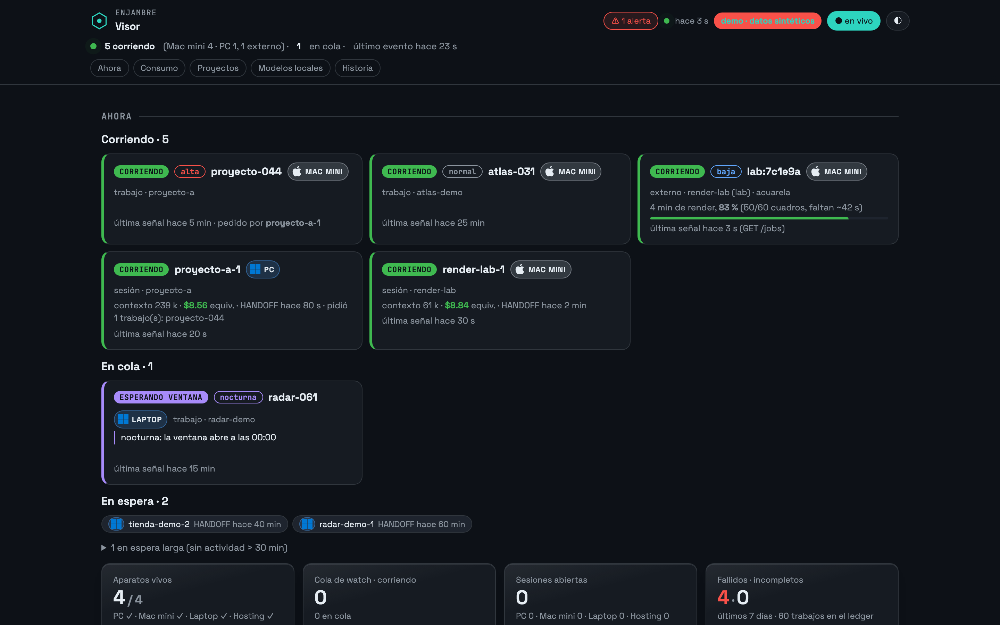
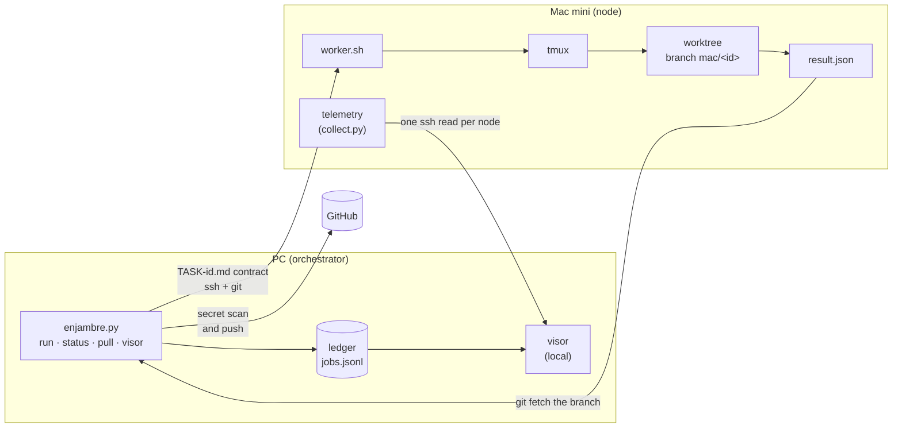

# enjambre

**English** · [Español](README.md)


**Distributed agentic coding on hardware you already own.** A Windows PC orchestrates; an Apple
Silicon Mac mini runs Claude Code jobs headless, each in its own git worktree. Every job comes back
as a reviewable branch plus one line in an append-only ledger. A local dashboard (the "visor")
shows nodes, jobs and telemetry.



*Capture of the visor in demo mode (`visor --demo`): a synthetic swarm with invented names, paths
and numbers. No image in this repository comes from a real environment.*

**Live demo:** [enjambre.ichisieben.dev](https://enjambre.ichisieben.dev) is that same page, static
(`visor --demo --export`): HTML and synthetic data, no process on the server.

Sibling project: [Claude Kit](https://github.com/IchiSieben/claude-kit) is the agent setup (rules,
subagents, hooks); enjambre is the distribution layer that spreads that work across machines.
On the Mac, the agents run with the Claude Kit setup.

## How it works



1. The PC validates the contract: a `TASK-<id>.md` with "Files you may touch" and "Done criteria",
   and an `AGENTS.md` in the repo.
2. The reserved-path rule runs first: a confidential repo only runs on owned nodes with the
   `claude` worker, and is refused before any network call.
3. The node creates a worktree on branch `mac/<id>`, runs the worker inside `tmux` (it survives an
   SSH drop) and commits `result.json`.
4. Nodes never push. The PC fetches the branch over SSH, scans exactly the new commits with
   gitleaks and pushes it.
5. Every run appends one line to the `jobs.jsonl` ledger: id, node, worker, branch, start and end,
   exit code, usage.

Without `--node`, `enjambre run` picks the machine from a table (`routing.toml`) plus live state,
and explains why in one line. No model makes that decision.

## How to run it

Requirements: Python 3 (standard library only), `ssh` and `git`. Demo mode needs no nodes.

```bash
cp nodes.example.toml nodes.toml          # then edit your nodes
python enjambre.py visor --demo           # synthetic swarm, no nodes needed -> state/visor/demo/visor.html
python enjambre.py visor --demo --serve   # same, fresh readings every 10 s
python enjambre.py visor --demo --export  # the static demo for shared hosting -> state/web-dist/demo/
python enjambre.py status
python enjambre.py run --kind tests --repo <repo> --task tasks/TASK-<id>.md --dry-run
python -m pytest -q --ignore=tests/node
python tools/publicar/auditar.py          # the publication audit (needs AUDITORIA_CLAVE)
```

`--dry-run` prints the chosen route and the reason without sending anything. Demo mode goes
through the same code as the real visor (collector, page builder, live assembly); only the data is
synthetic and repeatable.

## What it measures and produces

Each job leaves a branch and a ledger line. The visor adds up usage as two costs (API equivalent
and quota), keeps its own history, shows the cause of each failure and, per node, CPU, RAM with
pressure and swap, temperature, network and processes labeled with their job.

Measured figures (Mac mini M2 Pro 16 GB vs Windows 10, Intel i5-8600, 48 GB, Git Bash; median of 3
runs; 2026-10-04, [tutorial step 18](docs/tutorial/18-mac-vs-windows.md), in Spanish):

| Task | Windows | Mac | Mac faster by |
|---|---|---|---|
| Bash script tests (statusline) | 15.40 s | 1.08 s | 14x |
| Bash script tests (hooks) | 17.59 s | 1.03 s | 17x |
| Kit build | 16.98 s | 0.62 s | 27x |
| Python tests (38) | 0.55 s | 0.35 s | 1.6x |
| `git status` x20 | 1.42 s | 0.14 s | 10x |

The gap is in bash, not Python: on Windows every `jq`, `sed` or `date` pays for `fork` emulation.
That is a hypothesis consistent with the data, not a separate measurement.

Other dated figures:

- First real `claude` job: 44 s on the node, 51 s end to end, US$ 0.39 (2026-10-04). With the stub
  worker the whole round trip takes about 6 s.
- `ssh <node> true` latency (median of 10): 266 ms over Wi-Fi, 187 ms over Ethernet (measured
  2026-10-10).
- 2 GiB scp, PC to Mac: from 53.4 to 64.5 MB/s going from Wi-Fi to Ethernet (2026-10-10).
- Test suite: 405 passing in this public copy (Windows, 2026-10-11); CI runs it again on Linux on every push.
- A local 9B model got 1 of 3 functions right against hidden tests; `claude -p` got 3 of 3
  (2026-10-04). A local model does not replace the agent for code with exact rules.

## Honest limits

- Mac and Windows only today. Linux is not provisioned; the laptop as a third node is not in
  service and there is no committed date.
- Unattended `claude` jobs need the macOS keychain unlocked. After a reboot someone must log in
  once. With FileVault on there is no autologin, so nothing runs until then.
- One node, one worker per job; the queue lives only on the orchestrator.
- Exit codes do not check the done criteria: an `exit 0` can be a half-finished job. Reviewing the
  branch is still a human step.
- The visor is local-first. The web copy is optional and redacted through an allow-list.
- The figures come from a single pair of machines, few repetitions and some outside load: treat
  them as a ceiling, not an average.

## Security

No `--dangerously-skip-permissions`; explicit tool allow-lists; no secrets in the repo. Details and
how to report are in [SECURITY.md](SECURITY.md).

## Study material

[docs/ESTUDIO.md](docs/ESTUDIO.md) (Spanish) collects the concepts this project teaches, with their
stories in the iC7 Academy. The full tutorial (Spanish) is in [docs/tutorial/](docs/tutorial/README.md).

## Licenses

- Code: MIT.
- Bundled fonts, JetBrains Mono and Space Grotesk, under SIL OFL 1.1. Files and their licenses are
  in `tools/visor/fonts/`.
- devicon icons: MIT. Apple and Linux marks from simple-icons: CC0 (`tools/visor/icons/simple-*.svg`).
