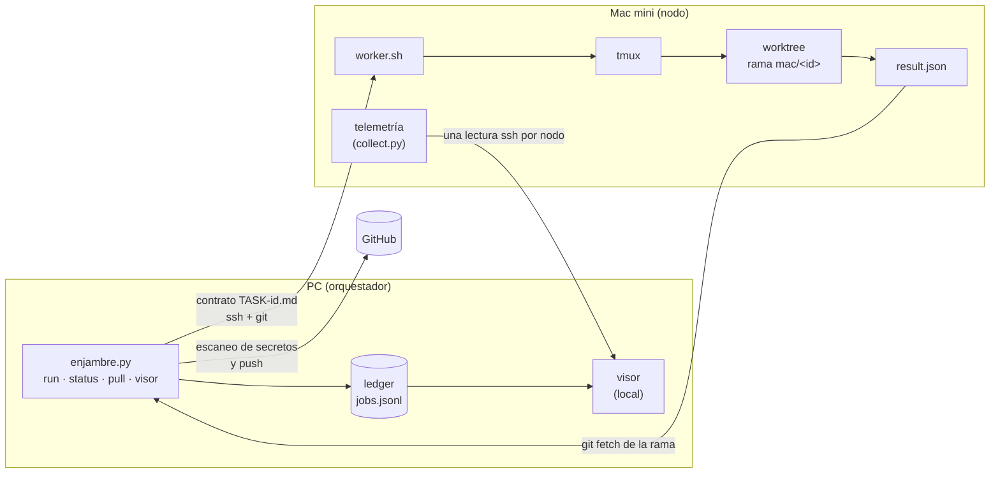

# enjambre

[English](README.en.md) · **Español**


**Programación con agentes repartida en el hardware que ya tienes.** Una PC con Windows orquesta;
una Mac mini con Apple Silicon ejecuta trabajos de Claude Code sin interfaz, cada uno en su propio
worktree de git. Cada trabajo vuelve como una rama revisable y una línea en un registro de solo
añadir. Un tablero local (el "visor") muestra nodos, trabajos y telemetría.


*Captura del visor en modo demo (`visor --demo`): un enjambre sintético, con nombres, rutas y cifras
inventados. Ninguna captura de este repositorio sale de un entorno real.*

**Demo en vivo:** [enjambre.ichisieben.dev](https://enjambre.ichisieben.dev) es esa misma página,
estática (`visor --demo --export`): HTML y datos sintéticos, ningún proceso en el servidor.

Proyecto hermano: [Claude Kit](https://github.com/IchiSieben/claude-kit) es la configuración del
agente (reglas, subagentes, hooks); enjambre es la capa de distribución que reparte ese trabajo
entre máquinas. En la Mac, los agentes corren con la configuración de Claude Kit.

## Cómo funciona



1. La PC valida el contrato: un `TASK-<id>.md` con "Archivos que puedes tocar" y "Criterios de
   hecho", y un `AGENTS.md` en el repo.
2. La regla de rutas reservadas corre primero: un repo confidencial solo se ejecuta en nodos
   propios, con el worker `claude`, y se rechaza antes de cualquier llamada de red.
3. El nodo crea un worktree en la rama `mac/<id>`, ejecuta el worker dentro de `tmux` (sobrevive a
   una caída de SSH) y hace commit de `result.json`.
4. Los nodos no hacen push. La PC trae la rama por SSH, escanea exactamente los commits nuevos con
   gitleaks y la sube.
5. Cada ejecución añade una línea al ledger `jobs.jsonl`: id, nodo, worker, rama, inicio y fin,
   código de salida, consumo.

Sin `--node`, `enjambre run` elige la máquina con una tabla (`routing.toml`) más el estado vivo, y
explica el porqué en una línea. Ningún modelo toma esa decisión.

## Cómo correrlo

Requisitos: Python 3 (solo biblioteca estándar), `ssh` y `git`. El modo demo no necesita nodos.

```bash
cp nodes.example.toml nodes.toml          # luego edita tus nodos
python enjambre.py visor --demo           # enjambre sintético, sin nodos -> state/visor/demo/visor.html
python enjambre.py visor --demo --serve   # igual, con lecturas nuevas cada 10 s
python enjambre.py visor --demo --export  # la demo estática para un hosting compartido -> state/web-dist/demo/
python enjambre.py status
python enjambre.py run --kind tests --repo <repo> --task tasks/TASK-<id>.md --dry-run
python -m pytest -q --ignore=tests/node
python tools/publicar/auditar.py          # la auditoría de publicación (requiere AUDITORIA_CLAVE)
```

`--dry-run` muestra la ruta elegida y el porqué sin enviar nada. El modo demo pasa por el mismo
código del visor real (recolector, constructor de la página, ensamblado en vivo); solo los datos
son sintéticos y repetibles.

Un repo nuevo en un nodo se clona una vez, sin agente: `python enjambre.py clone --node <nodo> <repo>`
(idempotente: responde `cloned` o `exists`, usa el `origin` del clon local o `--url`, y deja una línea
`worker: clone` en el registro). `--repo` es siempre el **nombre** de la carpeta bajo `<portfolio>/`,
nunca una ruta; la rama de partida se elige con `--ref <rama>`. Antes de lanzar, `run` comprueba por
ssh que `<portfolio>/<repo>/.git` existe en el nodo y, si no, falla en el acto con el comando `clone`
que lo arregla. Si un trabajo muere antes de arrancar, `status` lo muestra como `dead-at-launch` con
la razón, y `python enjambre.py logs <id>` trae los registros del lado del nodo.

## Qué mide y qué produce

Cada trabajo deja una rama y una línea de ledger. El visor suma el consumo en dos costos
(equivalente API y cuota), guarda su propio historial, muestra la causa de cada fallo y, por nodo,
CPU, RAM con presión y swap, temperatura, red y procesos etiquetados con su trabajo.

Cifras medidas (Mac mini M2 Pro 16 GB contra Windows 10, Intel i5-8600, 48 GB, Git Bash; mediana
de 3 corridas; 2026-10-04, [paso 18 del tutorial](docs/tutorial/18-mac-vs-windows.md)):

| Tarea | Windows | Mac | Mac más rápida |
|---|---|---|---|
| Tests de scripts bash (statusline) | 15,40 s | 1,08 s | 14x |
| Tests de scripts bash (hooks) | 17,59 s | 1,03 s | 17x |
| Build del kit | 16,98 s | 0,62 s | 27x |
| Tests Python (38) | 0,55 s | 0,35 s | 1,6x |
| `git status` x20 | 1,42 s | 0,14 s | 10x |

La diferencia está en bash, no en Python: en Windows cada `jq`, `sed` o `date` paga la emulación de
`fork`. Es una hipótesis coherente con los datos, no una medición aparte.

Otras cifras con fecha:

- Primer trabajo real con `claude`: 44 s en el nodo, 51 s de extremo a extremo, US$ 0,39
  (2026-10-04). Con el worker de prueba, el recorrido completo tarda unos 6 s.
- Latencia de `ssh <nodo> true` (mediana de 10): 266 ms por Wi-Fi, 187 ms por Ethernet
  (medido el 2026-10-10).
- Copia de 2 GiB por scp de la PC a la Mac: de 53,4 a 64,5 MB/s al pasar de Wi-Fi a Ethernet
  (2026-10-10).
- Suite de pruebas: 405 en verde en esta copia pública (Windows, 2026-10-11); el CI la repite en Linux en cada push.
- Un modelo local de 9B acertó 1 de 3 funciones con pruebas ocultas; `claude -p` acertó 3 de 3
  (2026-10-04). El modelo local no reemplaza al agente para código con reglas exactas.

## Límites honestos

- Solo Mac y Windows hoy. Linux no está aprovisionado; el portátil como tercer nodo no está en
  servicio y no hay fecha comprometida.
- Los trabajos desatendidos con `claude` necesitan el llavero de macOS desbloqueado. Tras un
  reinicio, alguien debe iniciar sesión una vez. Con FileVault activo no hay inicio de sesión
  automático, así que hasta entonces nada corre.
- Un nodo, un worker por trabajo; la cola vive solo en el orquestador.
- Los códigos de salida no verifican los criterios de hecho: un `exit 0` puede ser un trabajo a
  medias. Revisar la rama sigue siendo un paso humano.
- El visor es local primero. La copia web es opcional y redactada con lista de permitidos.
- Las cifras salen de un único par de máquinas y de pocas repeticiones, con carga ajena: son un
  techo, no un promedio.

## Seguridad

Sin `--dangerously-skip-permissions`; listas de herramientas permitidas explícitas; sin secretos en
el repo. Detalle y cómo reportar en [SECURITY.md](SECURITY.md).

## Estudio

[docs/ESTUDIO.md](docs/ESTUDIO.md) reúne los conceptos que enseña el proyecto, con sus historias en
la Academia de iC7. El tutorial completo (en español) está en [docs/tutorial/](docs/tutorial/README.md).

## Licencias

- Código: MIT.
- Tipografías incluidas, JetBrains Mono y Space Grotesk, bajo SIL OFL 1.1. Los archivos y sus
  licencias están en `tools/visor/fonts/`.
- Iconos de devicon: MIT. Marcas de Apple y Linux de simple-icons: CC0 (`tools/visor/icons/simple-*.svg`).
